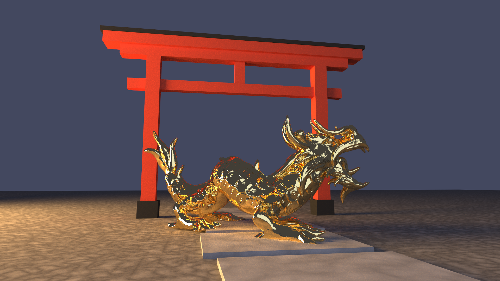
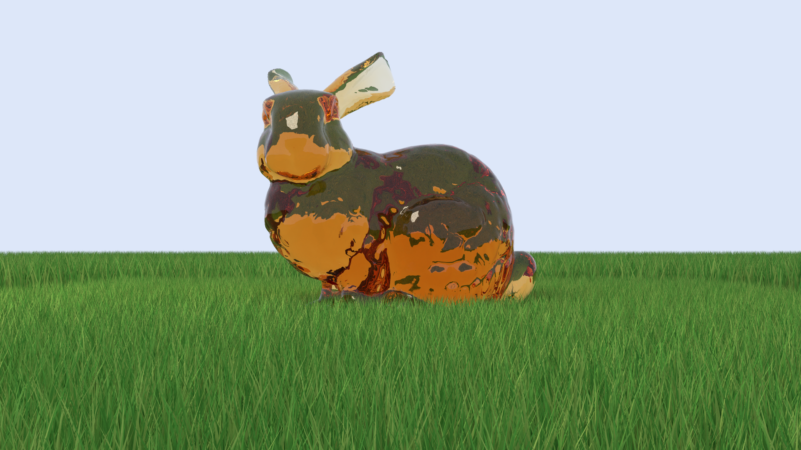
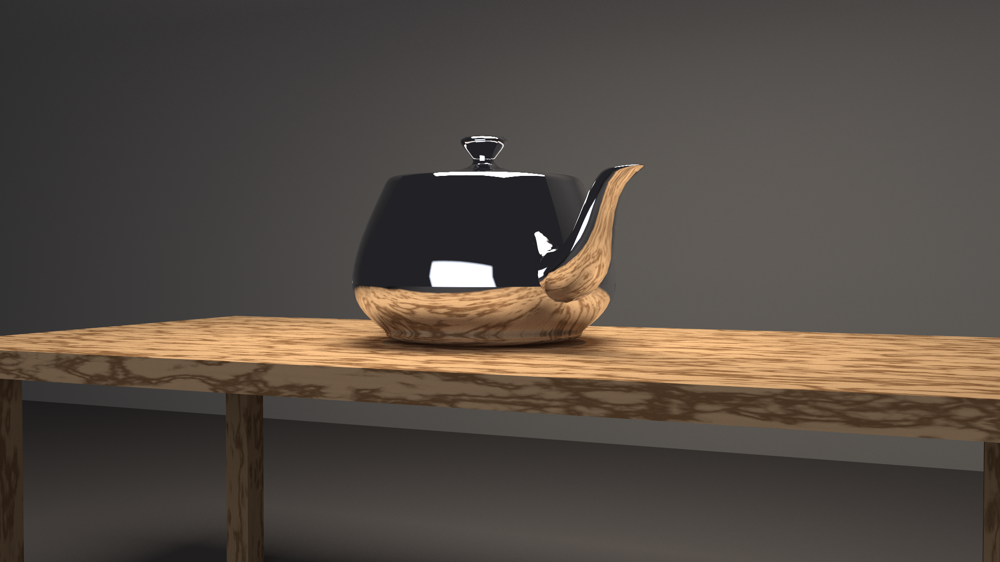
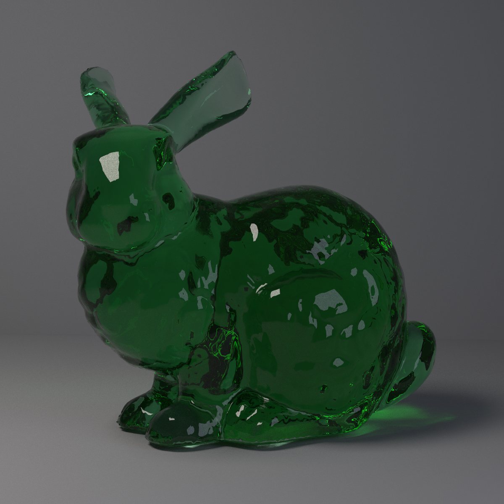
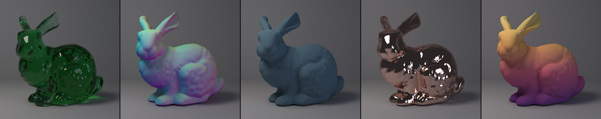
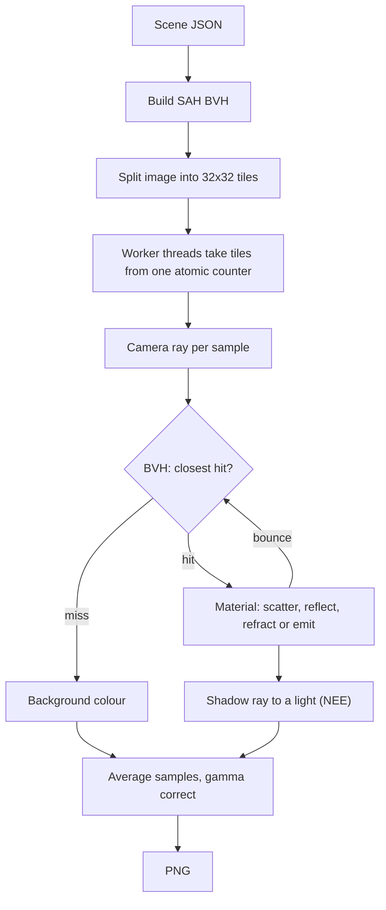
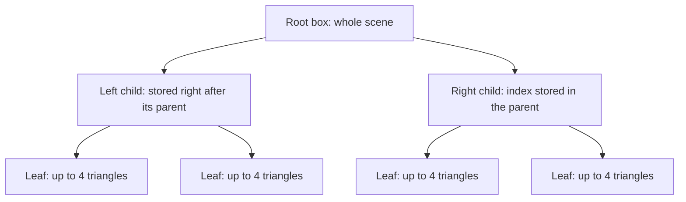
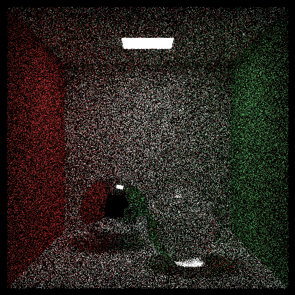
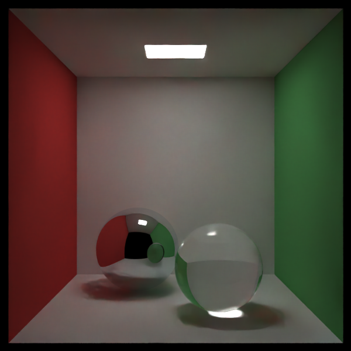

# Kiln

**A physically based path tracer in modern C++.**

[](https://github.com/Mohamed-Elkiky/Lumen/actions/workflows/ci.yml)
[](https://en.cppreference.com/w/cpp/17)
[](LICENSE)




No game engine, no graphics API, no GPU. Kiln computes every pixel by simulating how light bounces around a scene, the same way film renderers do.

- **~37,000x faster** than brute force on the 69k-triangle Stanford bunny, from a SAH BVH and a lock-free 24-thread renderer
- **Byte-identical output** on 1 or 24 threads, guarded by 48 tests and CI on Linux, macOS and Windows
- **A live preview window** that refines as you watch, **neural denoising**, and **JSON scene files** with errors that name the exact field

## Features

- **Materials:** matte, metal with roughness, glass (Snell's law, total internal reflection, Fresnel) and coloured glass with Beer's law absorption
- **Lighting:** emissive area lights with next event estimation, about 3x less noise at the same sample count
- **Meshes:** `.obj` loading, Möller-Trumbore intersection, smooth shading from vertex normals
- **BVH:** binned Surface Area Heuristic splits, stored flat in 64-byte nodes with an iterative traversal
- **Multithreading:** 32x32 tiles handed out by a single atomic counter, no locks on the framebuffer
- **Live preview:** an SDL2 window that refines from noise to clean, with orbit, zoom and camera export
- **Denoising:** Intel Open Image Denoise with albedo and normal guides
- **Procedural textures:** checker, Perlin noise, wood, normal, gradient and wireframe, all solid 3D, so no UVs needed
- **Scenes:** JSON files and a CLI, plus a grass generator that grows hundreds of thousands of blades from one object

## Gallery

| | |
|:---:|:---:|
|  |  |
| **Bunny in the grass.** Amber glass in 300,000 blades of generated grass, 1.57M triangles | **Teapot on the table.** Chrome reflecting a procedural wood grain |
|  |  |
| **Cornell box.** Colour bleeding, soft shadows and a caustic under the glass | **Emerald glass.** Thin ears glow, the thick body goes deep |

**Dragon at the shrine** (top of the page): the 250k-triangle XYZ RGB dragon in polished gold, in front of a torii gate built from 9 boxes.



**Five looks, one mesh: 69k triangles.** Same camera, light and pose; only the material changes. Open it full size to see every triangle in the wireframe.

<details>
<summary><b>From first light to the dragon: the build, one milestone at a time</b></summary>

| | | |
|:---:|:---:|:---:|
|  |  |  |
| Camera and rays | Ray-sphere intersection | Diffuse bounces and gamma |
|  |  |  |
| Matte and metal | Glass with refraction | Area lights |
|  |  |  |
| Triangles | Utah teapot | Stanford bunny |
|  | | |
| Dragon, 250k triangles | | |

</details>

Every scene is in [`scenes/`](scenes) and [`scenes/showcase/`](scenes/showcase).

## Performance

**The Stanford bunny renders ~37,000x faster than brute force, and the 250k-triangle dragon ~294,000x faster.**

`kiln_bench` on a Ryzen 9 7900X (12 cores, 24 threads), MSVC 19.44 Release, median of 3 runs. Full report in [docs/benchmarks.md](docs/benchmarks.md).

| Scene | Size | Brute force, 1 thread | BVH, 1 thread | BVH, 24 threads | Total speedup |
|---|---|---|---|---|---|
| Stanford bunny | 69k triangles | ~59 min | 1.29 s | **0.09 s** | **~37,000x** |
| XYZ RGB dragon | 250k triangles | ~9 h 18 min | 1.63 s | **0.11 s** | **~294,000x** |
| Cornell box | 8 objects | 10.5 s | 12.0 s | **0.88 s** | 11.9x |

`~` is an estimate: brute force on a mesh is rendered smaller and scaled up. A full brute-force bunny render, timed directly, took 3,703 s, within 5% of the estimate.

- **Logarithmic scaling.** The dragon has 3.6x more triangles than the bunny but takes only 1.3x as long.
- **SAH beats a median split** by 1.5x on the bunny and 1.7x on the dragon.
- **Threads scale 12.9x to 14.3x** on 24 threads. There are 12 physical cores; hyperthreads fill the idle cycles.
- **Small scenes don't need a BVH.** On the 8-object Cornell box, brute force is 1.1x faster.
- **Brute force hits a memory wall.** Per ray, it is 9.3x slower on the dragon than the bunny despite only 3.6x more triangles. The bunny likely fits in the 32 MB L3 cache; the dragon doesn't.

## How it works



1. The image is split into **32x32 tiles**, rendered in parallel by a pool of worker threads.
2. For each pixel, the **camera** fires many jittered rays (antialiasing).
3. Each ray walks the **BVH** to find the closest hit, skipping every box it misses along with everything inside.
4. The surface's **material** decides what happens next: scatter (matte), reflect (metal), refract or reflect (glass), or emit (lights).
5. At a matte surface, a **shadow ray** goes straight to a random point on a random light (next event estimation).
6. The ray **bounces**, picking up colour, until it escapes or hits the bounce limit.
7. Samples are **averaged**, gamma corrected and written to PNG.

Soft shadows, colour bleeding and caustics all fall out of the physics without being programmed in.

### BVH



- **Building:** at each node, primitives are binned into 16 buckets per axis, and the split with the lowest Surface Area Heuristic cost, `area(L) x count(L) + area(R) x count(R)`, wins. Big boxes are likelier to be hit, so SAH keeps them nearly empty.
- **Traversing:** visit the nearer child first and clip the far child to the closest hit so far, so most far-side boxes are rejected at once.
- **Storing:** one flat array of 64-byte nodes (one cache line each) in depth-first order, a loop with a fixed-size stack instead of recursion, and triangles copied into the BVH by value so they're tested with a direct call, not a virtual one. That's 1.12x to 1.42x faster than the pointer-based tree it replaced, with byte-identical output.

### Next event estimation

Pure path tracing only finds a light when a random bounce happens to hit it, which is rare for a small ceiling panel. So at every matte surface Kiln also fires a shadow ray at a random point on a random light, and adds that light directly if nothing blocks it. If the random bounce later lands on the same light, its glow is skipped, because the shadow ray already counted it. Mirrors and glass reflect in one exact direction, so they still find light by hitting it, which is how caustics survive. On the Cornell box at 16 spp this cuts the error against a converged reference by 3.2x.

### Multithreading and determinism

- **Tiles, not rows:** compact tiles keep neighbouring rays on the same BVH nodes, so the cache stays warm, and they balance uneven work.
- **Lock-free queue:** a single `std::atomic<int>`; each thread `fetch_add`s the next tile.
- **No framebuffer locks:** every pixel belongs to exactly one tile.
- **Per-tile seeding:** each thread's random generator is reseeded from the tile index, so a pixel's noise depends on its tile, not its thread. That's what makes output byte-identical at any thread count.

### Denoising

`--denoise` runs [Intel Open Image Denoise](https://www.openimagedenoise.org/), a neural denoiser, on the finished render. During the same render, Kiln records the **albedo** and **normal** of the first rough surface each ray reaches, looking through glass and mirrors, so the denoiser keeps real edges sharp.

| 16 spp | 16 spp + `--denoise` | 500 spp reference |
|:---:|:---:|:---:|
|  |  |  |

Same scene, 31x fewer samples.

## Build and run

You need **CMake 3.20+** and a **C++17 compiler** (GCC, Clang or MSVC). There are no other dependencies: SDL2 and OIDN are optional, and SDL2 downloads itself when you ask for it.

**Linux / macOS**

```bash
git clone https://github.com/Mohamed-Elkiky/Lumen.git kiln
cd kiln
cmake -B build -DCMAKE_BUILD_TYPE=Release
cmake --build build --parallel
./build/kiln scenes/cornell.json -o cornell.png
```

**Windows** (Visual Studio 2022 or its Build Tools, in PowerShell)

```powershell
git clone https://github.com/Mohamed-Elkiky/Lumen.git kiln
cd kiln
cmake -B build
cmake --build build --config Release --parallel
.\build\Release\kiln.exe scenes\cornell.json -o cornell.png
```

**Models.** The bunny, dragon and teapot are too large to commit. Download them into `assets/models/`:

```bash
mkdir -p assets/models
for m in teapot stanford-bunny xyzrgb_dragon; do
  curl -L -o assets/models/$m.obj https://raw.githubusercontent.com/alecjacobson/common-3d-test-models/master/data/$m.obj
done
```

```powershell
New-Item -ItemType Directory -Force assets\models | Out-Null
foreach ($m in "teapot", "stanford-bunny", "xyzrgb_dragon") {
  curl.exe -L -o assets\models\$m.obj https://raw.githubusercontent.com/alecjacobson/common-3d-test-models/master/data/$m.obj
}
```

**Options.** Flags override the scene file:

```bash
kiln scenes/bunny.json --samples 64 --width 800 -o bunny.png
kiln scenes/dragon.json --benchmark --runs 5
kiln --help
```

| Flag | Effect |
|---|---|
| `-o, --out FILE` | Output PNG (default `output.png`) |
| `-s, --samples N` / `-d, --depth N` / `-w, --width W` | Samples per pixel, max bounces, image width |
| `-t, --threads N` | Worker threads (default: all) |
| `--seed N` | Random seed; same seed, same image |
| `--no-bvh` / `--midpoint` | Brute force, or median-split BVH instead of SAH |
| `--no-nee` | Turn off next event estimation, for comparison |
| `--benchmark` | Time the render instead of saving it: median of `--runs` and Mrays/s |
| `--denoise` | Remove noise with Intel Open Image Denoise |
| `--preview` | Live window that refines as you watch |

**Live preview.** Build with `-DKILN_PREVIEW=ON` (SDL2 downloads and builds the first time), then run with `--preview`:

```bash
cmake -B build -DKILN_PREVIEW=ON
cmake --build build --config Release
./build/kiln scenes/cornell.json --preview
```

| Input | Action |
|---|---|
| Drag | Orbit the camera |
| Scroll | Zoom |
| `R` | Reset the view |
| `S` | Save the current image to `--out` |
| `C` | Print the camera as JSON, ready to paste into a scene file |
| `Esc` | Quit |

Worker threads render each pass while the main thread only handles input, so the window never stalls. Moving the camera cancels the pass in flight within one tile and starts again.

**Denoising.** Unzip an [OIDN 2.x release](https://github.com/RenderKit/oidn/releases) anywhere and point CMake at it. Without it, Kiln still builds and `--denoise` says it's unavailable.

```bash
cmake -B build -DCMAKE_PREFIX_PATH=/path/to/oidn-2.3.3.x86_64.linux
cmake --build build --config Release
./build/kiln scenes/cornell.json --samples 16 --denoise -o denoised.png
```

**Tests and benchmarks.**

```bash
ctest --test-dir build -C Release              # 48 tests across 11 suites
./build/kiln_bench --out docs/benchmarks.md    # benchmarks, from the repo root
```

The tests check, among other things, that the BVH returns the same closest hit as brute force on 20k random rays, output is pixel-identical on 1, 4 and 16 threads, NEE converges to the same brightness as plain path tracing, denoising 8 spp cuts the error against a 256 spp reference by over 4x, and every scene file error names the exact field.

Every push runs [GitHub Actions](.github/workflows/ci.yml): GCC and Clang on Linux with warnings as errors, Clang on macOS, MSVC on Windows with the preview window, ThreadSanitizer on the threaded code, and a pinned clang-format check. Each build job also uploads a real Cornell box render from its OS.

## Scene files

Every scene is a JSON file:

```json
{
  "camera":   { "look_from": [278, 278, -800], "look_at": [278, 278, 0], "fov": 40 },
  "settings": { "width": 600, "aspect_ratio": 1, "samples": 500, "depth": 50 },
  "materials": {
    "glass": { "type": "dielectric", "ior": 1.5 },
    "white": { "type": "lambertian", "albedo": [0.73, 0.73, 0.73] },
    "oak":   { "type": "lambertian", "albedo": { "texture": "wood", "colors": [[0.72, 0.5, 0.3], [0.38, 0.22, 0.1]], "axis": "x" } }
  },
  "objects": [
    { "type": "sphere", "center": [190, 90, 190], "radius": 90, "material": "glass" },
    { "type": "box", "min": [265, 0, 295], "max": [430, 330, 460], "material": "oak" }
  ]
}
```

- **Materials:** `lambertian`, `metal` (`fuzz`), `dielectric` (`ior`, plus optional `absorption` and `density` for coloured glass), `light` (`emit`)
- **Objects:** `sphere`, `quad`, `triangle`, `box`, `mesh` (`file`, plus `transform`: `scale`, `rotate_y`, `translate`) and `grass` (`area`, `count`, `materials`, plus optional `height`, `width`, `bend`, `seed` and `clear`)
- **Textures:** any `lambertian` or `metal` albedo can be a texture instead of a colour:

| `texture` | Fields |
|---|---|
| `checker` | `colors` (2), `scale` |
| `noise` | `colors` (2), `scale`, `seed` |
| `wood` | `colors` (light, dark), `axis` (grain direction), `center`, `ring_scale`, `noise`, `seed` |
| `normal` | none: colour from the direction the surface faces |
| `gradient` | `colors` (2 or more), `axis`, `from`, `to` |
| `wireframe` | `colors` (base, line), `width` |

Glowing quads and boxes are sampled directly as lights. Mesh paths are relative to the scene file, and `//` comments are allowed. Mistakes name the exact field:

```
error: scenes/cornell.json: objects[6].material: unknown material 'glas' (defined: glass, green, light, mirror, red, white)
```

## Project structure

```
kiln/
├── .github/        CI workflow
├── include/kiln/   Headers: maths, camera, materials, textures, shapes, lights, BVH, renderer, scene loader
├── src/            Implementation, main and benchmark
├── tests/          Unit tests (doctest) and .obj fixtures
├── scenes/         JSON scene files (showcase/ for the gallery)
├── scripts/        Five-looks strip builder
├── external/       Single-header libraries
├── assets/models/  Downloaded models (not committed)
├── renders/        Gallery and milestone renders
└── docs/           Benchmarks
```

## Roadmap

**Done**

- [x] **Foundations:** vectors, rays, camera, spheres, PNG output
- [x] **Materials and lighting:** matte, metal, glass, area lights, Cornell box
- [x] **Performance:** triangles, `.obj` meshes, SAH BVH, multithreading, benchmarks
- [x] **Polish:** JSON scenes and CLI, live preview, denoising, next event estimation, flat BVH, CI
- [x] **Showcase:** procedural textures, coloured glass, wireframe, grass generator, showcase scenes

**Next**

- [ ] GPU path tracing (CUDA or Vulkan compute)
- [ ] HDR environment lighting
- [ ] Image textures with UV mapping
- [ ] Multiple importance sampling and microfacet (GGX) materials
- [ ] Rotation on every axis, and mesh instancing

## References

**Books**
- Shirley, Black, Hollasch: *Ray Tracing in One Weekend* series
- Pharr, Jakob, Humphreys: *Physically Based Rendering: From Theory to Implementation*

**Papers**
- Kajiya: *The Rendering Equation*, SIGGRAPH (1986)
- Veach: *Robust Monte Carlo Methods for Light Transport Simulation*, PhD thesis, Stanford (1997)
- Schlick: *An Inexpensive BRDF Model for Physically-based Rendering*, Computer Graphics Forum (1994)
- Möller, Trumbore: *Fast, Minimum Storage Ray/Triangle Intersection*, Journal of Graphics Tools (1997)
- Kay, Kajiya: *Ray Tracing Complex Scenes*, SIGGRAPH (1986)
- Williams, Barrus, Morley, Shirley: *An Efficient and Robust Ray-Box Intersection Algorithm*, Journal of Graphics Tools (2005)
- Goldsmith, Salmon: *Automatic Creation of Object Hierarchies for Ray Tracing*, IEEE CG&A (1987)
- MacDonald, Booth: *Heuristics for Ray Tracing Using Space Subdivision*, The Visual Computer (1990)
- Wald: *On fast Construction of SAH-based Bounding Volume Hierarchies*, IEEE Symposium on Interactive Ray Tracing (2007)
- Perlin: *Improving Noise*, SIGGRAPH (2002)

**Models**
- The Cornell Box, Cornell University Program of Computer Graphics
- The Stanford 3D Scanning Repository (bunny, XYZ RGB dragon), via common-3d-test-models (the `.obj` downloads and the Utah teapot)

**Third-party code:** stb_image_write (public domain / MIT), tinyobjloader (MIT), nlohmann/json (MIT), CLI11 (BSD-3-Clause), doctest (MIT), Intel Open Image Denoise (Apache-2.0, optional), SDL2 (zlib, optional)

## License

[MIT](LICENSE) © 2026 Mohamed Elkiky

## Contact

Want to collaborate on Kiln or another project? Message me on LinkedIn or email [moh.elkiky@gmail.com](mail to:moh.elkiky@gmail.com).

LinkedIn link: https://www.linkedin.com/in/mohamed-elkiky-3a57042b6/